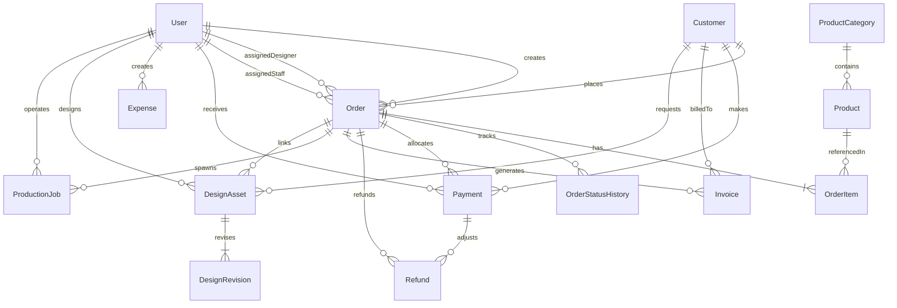

# Database Schema & Entity-Relationship (ER) Documentation
## Al-Bari Press & Digital Sign Management System

### 1. Entity-Relationship Diagram

---

### 2. Table Definitions

#### `User`
Stores staff, administrative, and customer authentication credentials.
- `id`: String (UUID, Primary Key)
- `username`: String (Unique)
- `email`: String (Optional, Unique)
- `passwordHash`: String (Bcrypt salt rounds 10)
- `fullName`: String (English name)
- `fullNameBn`: String (Bengali name)
- `phone`: String (Optional)
- `role`: Enum (`OWNER`, `MANAGER`, `DESIGNER`, `STAFF`, `CUSTOMER`)
- `active`: Boolean (Default: true)
- `createdAt`, `updatedAt`: Timestamps

#### `Customer`
Centralized repeat client database preventing duplicated customer accounts.
- `id`: String (UUID, Primary Key)
- `customerCode`: String (Unique, e.g. `CUST-0001`)
- `fullName`: String
- `fullNameBn`: String (Optional)
- `phone`: String (Unique, Indexed)
- `email`: String (Optional)
- `address`, `addressBn`: String (Optional)
- `customerType`: Enum (`INDIVIDUAL`, `BUSINESS`, `SCHOOL_COLLEGE`, `UNIVERSITY`, `ORGANIZATION`, `RESELLER`)
- `organizationName`: String (Optional)
- `notes`: Text

#### `ProductCategory`
- `id`: String (UUID, Primary Key)
- `name`, `nameBn`: String
- `slug`: String (Unique)
- `icon`: String
- `sortOrder`: Integer

#### `Product`
- `id`: String (UUID, Primary Key)
- `categoryId`: String (Foreign Key -> `ProductCategory.id`)
- `name`, `nameBn`: String
- `slug`: String (Unique)
- `basePrice`: Float (Default: 0.0)
- `unit`: Enum (`PIECE`, `SET`, `COPY`, `PAGE`, `SQFT`, `SQM`, `DOZEN`, `CUSTOM`)
- `unitBn`: String (e.g. `টি`, `বই`, `বর্গফুট`)
- `availableSizes`: JSON String
- `material`, `materialBn`: String (e.g. `Art Card 300 GSM`)
- `leadTimeDays`: Integer (Default: 3)
- `imageUrl`: String

#### `Order`
- `id`: String (UUID, Primary Key)
- `orderNumber`: String (Unique, e.g. `PR-2026-0001`)
- `customerId`: String (Foreign Key -> `Customer.id`)
- `createdById`: String (Foreign Key -> `User.id`)
- `assignedDesignerId`: String (Foreign Key -> `User.id`, Optional)
- `assignedStaffId`: String (Foreign Key -> `User.id`, Optional)
- `orderDate`: Timestamp (Default: now)
- `deliveryDate`: Timestamp (Optional)
- `productionStatus`: Enum (`DRAFT`, `PENDING`, `CONFIRMED`, `IN_PRODUCTION`, `QUALITY_CHECK`, `READY_FOR_DELIVERY`, `DELIVERED`, `CANCELLED`)
- `paymentStatus`: Enum (`UNPAID`, `PARTIALLY_PAID`, `PAID`, `REFUNDED`, `PARTIALLY_REFUNDED`)
- `priority`: Enum (`LOW`, `NORMAL`, `HIGH`, `URGENT`)
- `subtotal`: Float
- `discount`: Float
- `deliveryCharge`: Float
- `additionalCharges`: Float
- `totalAmount`: Float
- `amountPaid`: Float
- `amountDue`: Float
- `customerNotes`: Text
- `internalNotes`: Text
- `trackingToken`: String (Unique, 32-character crypto hex)

#### `OrderItem`
- `id`: String (UUID, Primary Key)
- `orderId`: String (Foreign Key -> `Order.id`, Cascade Delete)
- `productId`: String (Foreign Key -> `Product.id`, Optional)
- `productName`, `productNameBn`: String
- `specifications`: String
- `quantity`: Float
- `unit`, `unitBn`: String
- `unitPrice`: Float
- `subtotal`: Float

#### `Payment`
- `id`: String (UUID, Primary Key)
- `paymentNumber`: String (Unique, e.g. `PAY-2026-0001`)
- `orderId`: String (Foreign Key -> `Order.id`)
- `customerId`: String (Foreign Key -> `Customer.id`)
- `amount`: Float
- `method`: Enum (`CASH`, `BKASH`, `NAGAD`, `BANK_TRANSFER`, `CHEQUE`, `OTHER`)
- `referenceNumber`: String (TrxID or Cheque Number)
- `paymentDate`: Timestamp
- `receivedById`: String (Foreign Key -> `User.id`)
- `receiptNumber`: String (e.g. `RCT-2026-0001`)

#### `Expense`
- `id`: String (UUID, Primary Key)
- `expenseNumber`: String (Unique, e.g. `EXP-2026-0001`)
- `date`: Timestamp
- `category`: Enum (`PAPER_RAW_MATERIALS`, `INK_TONER`, `PRINTING_PRODUCTION`, `STAFF_SALARY`, `ELECTRICITY`, `MACHINE_MAINTENANCE`, `RENT`, `DELIVERY`, `PACKAGING`, `SOFTWARE_INTERNET`, `OTHER`)
- `amount`: Float
- `paymentMethod`: String
- `vendor`: String
- `description`: Text
- `createdById`: String (Foreign Key -> `User.id`)
- `approved`: Boolean (Default: true)

#### `DesignAsset` & `DesignRevision`
- `id`: String (UUID, Primary Key)
- `designCode`: String (Unique, e.g. `DSN-2026-0001`)
- `title`, `titleBn`: String
- `category`: String
- `artworkUrl`: String
- `revisionNumber`: Integer
- `status`: Enum (`DRAFT`, `IN_REVIEW`, `REVISION_REQUESTED`, `APPROVED`, `ARCHIVED`)
- `dimensions`, `colorMode`, `resolution`: String

#### `ProductionJob`
- `id`: String (UUID, Primary Key)
- `jobCode`: String (Unique, e.g. `PRD-2026-0001`)
- `orderId`: String (Foreign Key -> `Order.id`)
- `stage`: Enum (`ORDER_CONFIRMED`, `DESIGN_PREP`, `CUSTOMER_APPROVAL`, `PREPRESS`, `PRINTING`, `FINISHING`, `QUALITY_CHECK`, `READY_FOR_DELIVERY`, `DELIVERED`)
- `quantityOrdered`, `quantityProduced`, `quantityWasted`: Float
- `machineNotes`: Text
- `status`: Enum (`IN_PROGRESS`, `COMPLETED`, `ON_HOLD`)

#### `BusinessSettings`
Singleton configuration record holding press profile, address in Bengali and English, hotline, currency symbols, and invoice terms.
