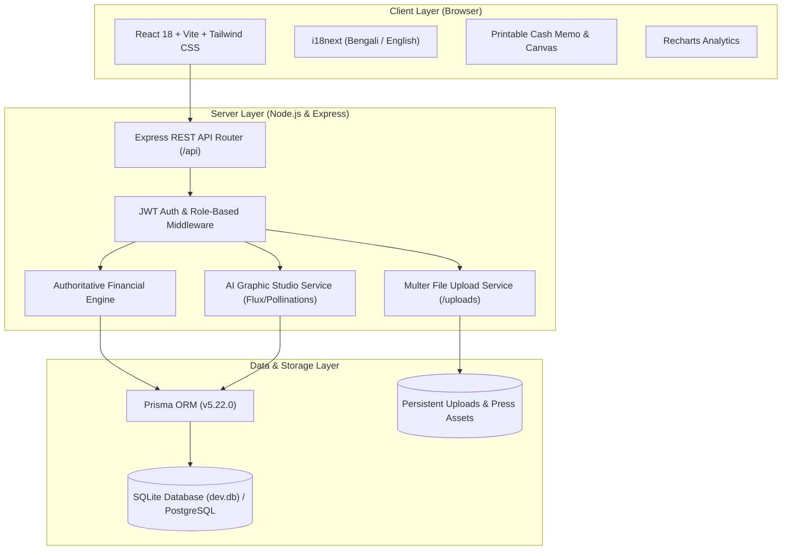

# Technical Requirements Document (TRD)
## Complete Printing Press Management & AI Design Platform

### 1. System Architecture Overview



---

### 2. Technology Stack Specifications

#### 2.1 Frontend
- **Framework**: React 18.3.1 with TypeScript 5.7
- **Bundler & Tooling**: Vite 5.4.21
- **Styling**: Tailwind CSS 3.4.17 with CSS variables and dark mode support
- **Icons**: Lucide React 0.468
- **Routing**: React Router DOM 6.28
- **Internationalization**: i18next 24.2 + react-i18next 15.2 + i18next-browser-languagedetector
- **Charts & Data Visualization**: Recharts 2.15
- **Fonts**: Hind Siliguri, Noto Sans Bengali (Bengali), Manrope, Geist (English/Numbers)

#### 2.2 Backend
- **Runtime**: Node.js v26.12.0
- **Framework**: Express 4.21.2 with TypeScript
- **Database ORM**: Prisma 5.22.0
- **Database Engine**: SQLite (`dev.db`) for zero-configuration, persistent ACID storage; schema is fully compatible with managed PostgreSQL.
- **Authentication**: JSON Web Tokens (`jsonwebtoken` 9.0.2) + `bcryptjs` 2.4.3
- **File Uploads**: `multer` 1.4.5 with 50MB per-file upload ceiling and MIME type validation
- **Testing Framework**: Vitest 2.1.8 + Supertest 7.0.0

---

### 3. Authoritative Financial Algorithms

```typescript
// Subtotal calculation
subtotal = Sum(item.quantity * item.unitPrice)

// Total billing calculation
totalAmount = Max(0, subtotal - discount + deliveryCharge + additionalCharges)

// Outstanding balance
amountDue = Max(0, totalAmount - totalAllocatedPayments)

// Payment status state machine
if (refundAmount > 0 && netPaid <= 0) status = 'REFUNDED'
else if (refundAmount > 0 && netPaid < totalAmount) status = 'PARTIALLY_REFUNDED'
else if (netPaid >= totalAmount && totalAmount > 0) status = 'PAID'
else if (netPaid > 0 && netPaid < totalAmount) status = 'PARTIALLY_PAID'
else status = 'UNPAID'
```

---

### 4. High-Resolution AI Image Generation Pipeline

1. User supplies natural language prompt in Bengali or English.
2. Prompt is augmented on the server with print-ready parameters:
   `"${userPrompt}, professional graphic design for high-resolution printing, CMYK ready, sharp typography, vector aesthetic, balanced layout"`.
3. Dispatched to configured AI provider:
   - **Pollinations Flux**: Dynamic dimensions (1024x1024, 1280x720, 1000x1250, 720x1280) via seed randomization.
   - **OpenAI DALL-E 3 / Gemini Imagen**: Enabled when corresponding API keys are present.
   - **Local Asset Engine Fallback**: Automatically serves verified authentic Al-Bari Press graphic templates if offline or when rate limits occur.
4. Generated artwork can be saved directly into `DesignAsset` with revision records.
